## 摘要
本实验在新闻组文本 10 分类任务上，以 TF-IDF 为特征表示，对比了朴素贝叶斯、逻辑回归、线性支持向量机（LinearSVC）与多层感知机（MLP）四种分类器。实验遵循"先划分、后处理"的规范，采用 5 折 ×5 次重复分层交叉验证（25 个估计值）评估，并以**逐折配对 t 检验**判定差异显著性。

最终方案为：删除邮件路由元数据、保留 Subject，TF-IDF 取 **`max_features=50000`**（词表在 5 万~10 万之间饱和，再往上收益不足 0.001）并启用 `sublinear_tf`，分类器用 LinearSVC（C=1）。**嵌套交叉验证给出的无偏 Macro-F1 为 0.9453**；同口径的 25 折结果为 0.9434，相对未调优基线（0.9156）提升 **0.0278**。

主要结论有四：其一，**多数常规文本清洗是无效操作**——去标点、去停用词、stemming 的效应在统计上与零不可区分；其二，**`max_features` 是唯一的大杠杆，且方向与直觉相反**：特征越多表现越好，直到用尽全词表，且泛化间隙同时下降；其三，**MLP 在放开维度后追平了 LinearSVC，但差距在统计上不可区分，而训练时间贵两个数量级**；其四，**"模型之间的差距"很大程度上其实是"调参程度之间的差距"**——四个模型并排比较时极差为 0.0258，但把 LogisticRegression（C=100）与 NaiveBayes（alpha=0.1）也各自调到最优后，极差缩到 **0.0054**，四个结构迥异的分类器最终挤在同一水平线上，说明在本任务上**特征与正则化比模型选择更重要**。错误分析显示，全部主要混淆对都落在计算机相关的四个类别内部，说明剩余误差源于词袋表示下的类别词汇重叠，而非模型能力不足。

---

## 一、实验原理

### 1.1 文本表示：TF-IDF

TF-IDF 将文档表示为词权重向量：

- **TF（词频）**：词在文档中出现越多越重要。本实验用对数压缩形式 `1+log(tf)`（`sublinear_tf=True`），抑制长文档中高频词的主导。
- **IDF（逆文档频率）**：词在越多文档中出现，区分能力越弱。这一项使**停用词自动趋近零权重**，也自动压低极低频词的相对影响。

两者相乘后做 L2 归一化，得到稀疏高维向量。本语料全词表 107,882 个词元（删路由头后 104,468），单篇文档平均仅 135 个非零项——**稠密度约 0.27%**。

### 1.2 四个分类器

| 模型 | 判别形式 | 主要超参 |
|---|---|---|
| 朴素贝叶斯 | 基于特征条件独立假设的生成式模型 | `alpha`（拉普拉斯平滑） |
| 逻辑回归 | 线性判别 + Logistic 链接，最小化交叉熵 | `C`（正则强度倒数）、`penalty` |
| LinearSVC | 线性判别，最大化间隔 | `C`（惩罚力度）、`kernel` |
| MLP | 含隐层的非线性网络 | `hidden_layer_sizes`、`alpha`、早停 |

### 1.3 先验假设

文本分类的经典结论是线性模型表现优异。其机制假设为：**高维稀疏空间中数据近似线性可分**。本实验的核心工作之一，就是检验这个假设是否在本数据集上成立，以及非线性模型能否带来增量。

---

## 二、实验设置

### 2.1 数据

| 项 | 值 |
|---|---|
| 训练集 | 7368 条，10 类各 705~747 条（**高度均衡**） |
| 测试集 | 2457 条（助教提供，全程密封） |
| 文本长度 | 中位 1139 字符，最长 160616（跨度三个数量级） |
| 结构特征 | 100% 样本带邮件头（占全文 10.3%）；50.7% 含引用行；35.4% 含签名档 |

### 2.2 数据划分

**采用 `RepeatedStratifiedKFold(n_splits=5, n_repeats=5, random_state=42)`，即 5 折 ×5 重复 = 25 个估计值。**

选择依据不是"CV 通常更稳"，而是量化对照。固定同一分类器、只改随机种子，比较两种方案的估计稳定性：

| 划分方案 | 估计值标准差 | 极差 |
|---|---|---|
| 单次 holdout 80/20（10 个种子） | 0.0070 | 0.0207 |
| **5 折 CV（6 个种子）** | **0.0025** | **0.0073** |

单次划分换一个种子，估计值就波动 0.02 个点——**比模型之间的真实差距还大**。

因此本实验统一采用 **5 折 ×5 重复分层交叉验证**：5 次不同的随机划分各切 5 折，共给出 25 个估计值，报告其均值 ± 标准差。（重复的价值在于每个样本被验证 5 次、覆盖 5 套不同的划分；本节证据只支持"CV 优于单次划分"，不支持"重复次数越多越稳"——后者未做单独验证，见报告局限性。）

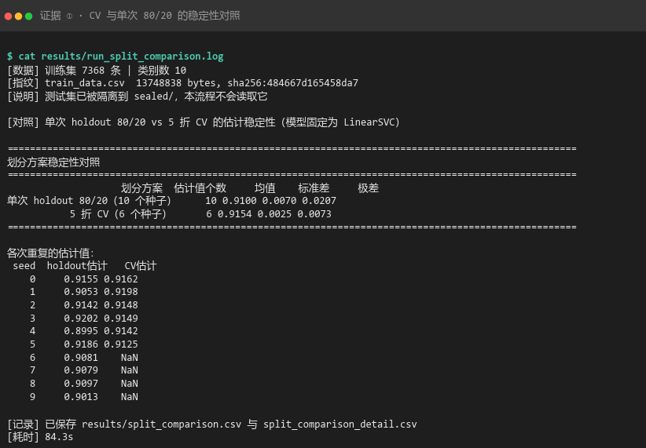


分层验证：25 折逐折检查类别占比，相对全集最大偏差仅 **0.0006**。

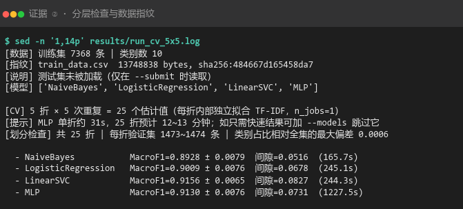


### 2.3 防数据泄露

我们落实了三条措施：

1. **先划分、后处理。** 清洗规则本身无状态，但 TF-IDF 的词表与 IDF **只在训练折上拟合**。实现上通过 `Pipeline(TfidfVectorizer → clf)` 保证结构上不可能泄露。
2. **测试集气隙隔离。** 测试集移出工作目录，代码中只有提交分支能读取它；读取前逐字节校验 SHA256（实测翻转 1 个字节即可拦截），每次运行日志都记录数据指纹，用于自证测试集未被改动。
3. **数据增强只在折内做。** 若先增广再划分，同一文本的原始版与扰动版会分落训练折与验证折，造成隐蔽泄露。本实验只增广每折的训练部分，验证部分保持原始文本。

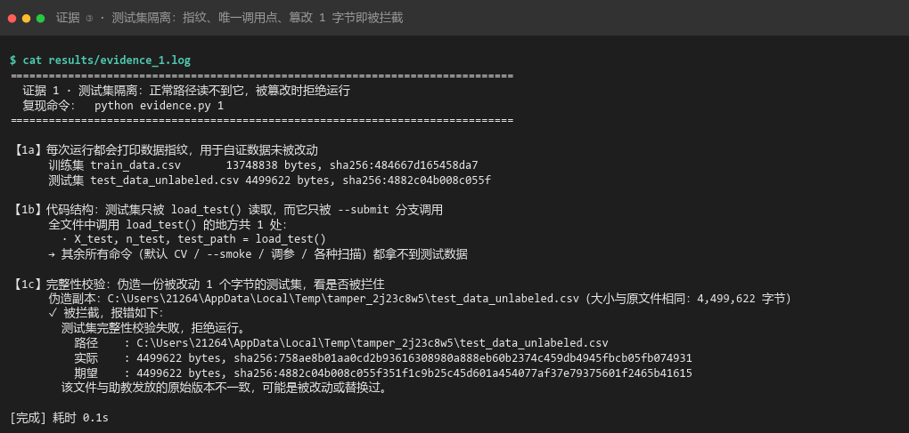


### 2.4 评估协议

统一报告 **Accuracy / Macro-F1 / Weighted-F1**，并记录**泛化间隙**（训练 Macro-F1 − 验证 Macro-F1）。

**所有"某方案更好"的结论都经过逐折配对 t 检验。** 同一批折中，每一折的难度是各方案共有的；逐折配对做差可消除这份共同方差，因此远比"比较两个独立的均值±标准差"灵敏。判读规则取保守口径：25 折检验（偏乐观）与按重复聚合检验（偏保守）**两者都显著**才判显著。

---

## 三、结果与评估

本章按"先看总账、再拆来源、再比模型、最后看它错在哪"的顺序展开，每小节都是**一张图 + 几句结论**。

### 3.1 总成绩（主结果）

**一句话**：最终方案是 **删路由头（留 Subject）+ `max_features=50000` + `sublinear_tf=True` + LinearSVC(C=1)**，25 折 Macro-F1 = **0.9434 ± 0.0062**，相对基线提升 **+0.0278**。

#### （1）从基线到最终：四个模型全部受益

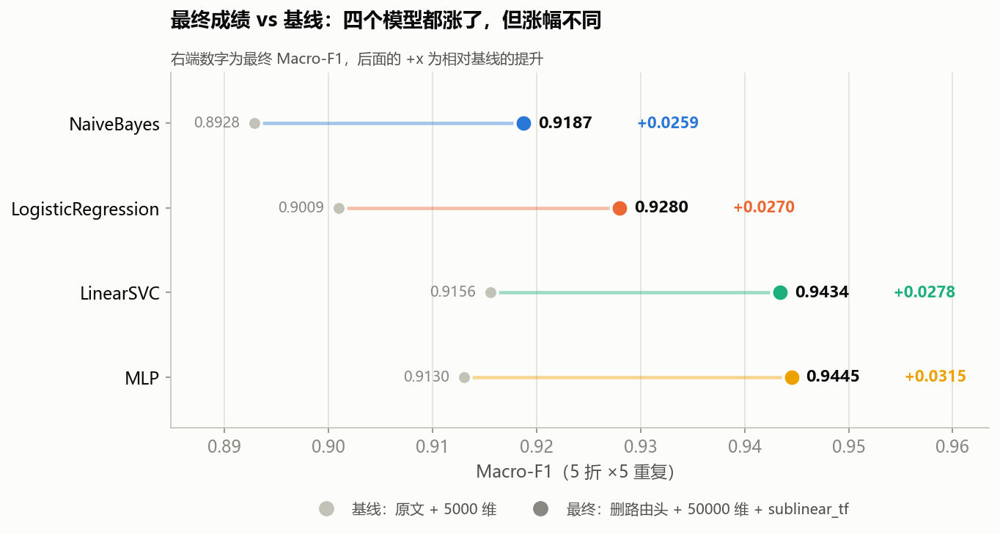

| 模型 | Accuracy | **Macro-F1** | Weighted-F1 | 训练-MacroF1 | 泛化间隙 | 25 折耗时 | 相对基线 |
|---|---|---|---|---|---|---|---|
| **MLP** | 0.9442 ± 0.0064 | **0.9445 ± 0.0063** | 0.9444 ± 0.0063 | 0.9939 | **0.0494** | 19457 s ※ | **+0.0315** |
| **LinearSVC** | 0.9432 ± 0.0063 | **0.9434 ± 0.0062** | 0.9433 ± 0.0063 | 0.9996 | 0.0562 | **79 s** | +0.0278 |
| LogisticRegression | 0.9276 ± 0.0063 | 0.9280 ± 0.0062 | 0.9280 ± 0.0062 | 0.9863 | 0.0584 | 240 s | +0.0270 |
| NaiveBayes | 0.9186 ± 0.0060 | 0.9187 ± 0.0060 | 0.9187 ± 0.0060 | 0.9752 | 0.0565 | 114 s | +0.0259 |

基线 = 原文 + 5000 维（`results/cv_5x5.csv`）；最终 = 上表第一行小标题所述配置（`results/model_metrics_routing_best_5x5.csv`）。四模型共用同一批 25 折。

※ **耗时列是墙钟时间，只作量级参考、不作论断依据。** 同一配置跑两遍，Macro-F1 逐位相同、耗时却差 1.6～2.9 倍；成本论断一律改用受控单折测量，详见 §3.5。分数列不受影响——它们由预测结果算得，与运行时长无关。

> ### ⚠️ 读"排序"之前必读：问题不在"我调了谁"，而在"默认值离最优有多远"
>
> 上表里四个模型**用的都是各自库的默认超参数**——包括 LinearSVC 的 `C=1`，那也是 sklearn 的默认值。
>
> 真正的差别在于：**默认值离各自最优点的远近，天差地别。**
> LinearSVC 的默认 `C=1` 恰好**就在**它的最优点上（我们扫过 5 个取值验证过，见 §3.4）；
> MLP 的默认 `(100, alpha=1e-4)` 也**落在整张 12 组网格的最优点旁边**（§3.4）；
> 而 LR 的默认 `C=1` 与 NB 的默认 `alpha=1.0` **都远离各自的最优**。
>
> 把 LR 与 NB 调到各自最优后（其余条件完全不变：
> 同一批 25 折、同一条代码路径、同一求解器）：
>
> | 模型 | 上表值（默认参数） | 自身最优配置 | 调参后 | 变化 |
> |---|---|---|---|---|
> | **MLP** | 0.9445 | 完整网格 12 组：`(100,)` 即最优结构；最优 alpha=1e-3 | 0.9445 | **−0.00005（无提升）** |
> | **LinearSVC** | 0.9434 | C=1（已扫过） | 0.9434 | — |
> | **LogisticRegression** | 0.9280 | C=100、l2 | **0.9405** | **+0.0125** |
> | **NaiveBayes** | 0.9187 | alpha=0.1 | **0.9391** | **+0.0204** |
>
> **四个模型的极差从 0.0258 缩到 0.0054。** 也就是说，上表表面显示的"模型差距"里，
> **约八成来自"默认值恰好对/恰好错"，而不是模型能力。**
>
> 值得注意的是：**MLP 与 LinearSVC 的调参收益都是 0**——MLP 网格最优的 alpha 拿去跑 25 折，
> 比默认值还低 0.00005；LinearSVC 的默认 C=1 本身就是最优点。**真正被默认值拖累的只有 LR 与 NB。**
>
> **配对检验的结论也随之改变**：调参后 **LR(C=100) 与 NB(alpha=0.1) 统计上不可区分**
> （Δ=+0.0014，95% CI 跨零）——而上表里这两者相差 0.0092 且被判为"显著"。
>
> **为什么会这样**（机制，非托辞）：
> - **LR vs LinearSVC**：LinearSVC 默认 `loss='squared_hinge'`，对分错样本是**二次**惩罚；
>   LR 的 log-loss 在 margin 很负时只**线性**增长。同一个 `C` 下前者数据项的拉力强得多，
>   所以 `C=1` 对 LinearSVC 已经够，对 LR 却等于被正则压死。
> - **NB**：`MultinomialNB` 假设输入是**计数**，而 TF-IDF 是归一化后的连续值（量级 0~1）。
>   `alpha=1.0` 的拉普拉斯平滑对这么小的"计数"来说，等于先验压过了证据本身。
>
> **这个现象本身值得记一笔**：四个结构完全不同的分类器（生成式 / 线性判别 / 最大间隔 /
> 非线性网络），在配置得当后挤进 **0.005** 的区间内。这与 §5.1 的机制一致——高维稀疏词袋下
> 数据近似线性可分，判别信息主要是"大量弱信号的累加"，因此**用什么模型，远不如"特征给够、
> 正则调对"重要**。

**读图三句**：① 四个模型**全部**从调参中受益（+0.026 ~ +0.032），不是某个模型的偶然；② 三个指标（Accuracy / Macro-F1 / Weighted-F1）几乎完全重合，说明**没有哪一类被牺牲掉**——若某一类崩了，Macro-F1 会明显低于另外两个；③ 泛化间隙同时下降（如 LinearSVC 0.0827 → 0.0562），说明提升不是靠记住训练集换来的。

#### （2）这 2.8 个点是两步挣来的

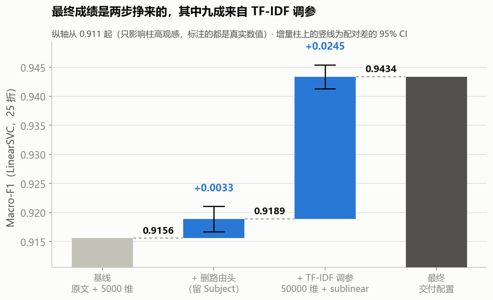

| 步骤 | 分数变化 | Δ（配对 95% CI） |
|---|---|---|
| 基线：原文 + 5000 维 | 0.9156 | — |
| + 删路由头（留 Subject） | → 0.9189 | **+0.0033** [+0.0011, +0.0055] |
| + TF-IDF 调参（50000 维 + `sublinear_tf`） | → 0.9434 | **+0.0245** [+0.0225, +0.0266] |

两步的 95% 置信区间都不跨零，**都是真实增益**。但**九成来自 TF-IDF 调参**（0.0245 / 0.0278）。
这个比例也预告了后文的结论：**文本清洗大多是无效操作，真正的杠杆在特征表示**（详见 §3.2、§3.3）。

#### （3）四个模型谁强谁弱

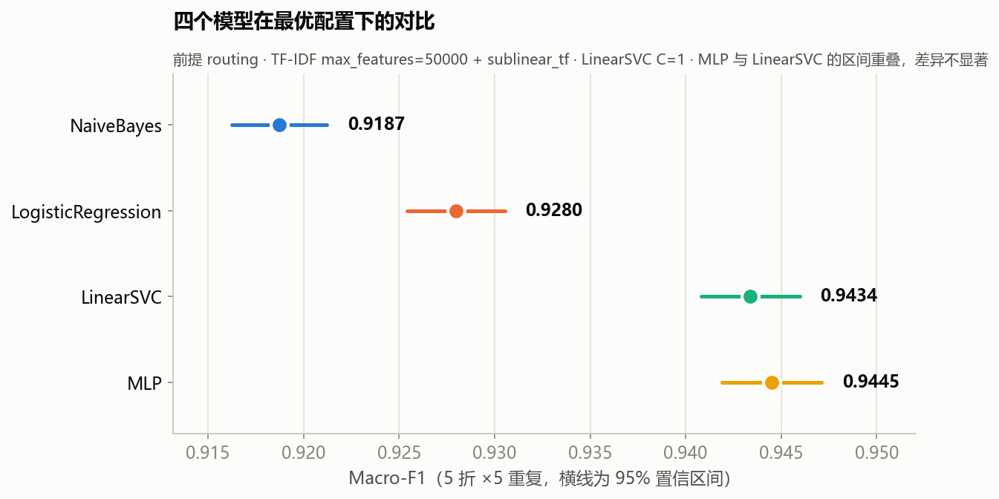

上图每个点是一折的分数、横线是 95% 置信区间。**MLP 与 LinearSVC 的区间几乎重叠**——看均值分不出高下，必须做配对检验：

| 模型 A | 模型 B | Δ | 95% CI | 结论 |
|---|---|---|---|---|
| NaiveBayes | LogisticRegression | −0.0092 | [−0.0112, −0.0073] | 显著 |
| NaiveBayes | LinearSVC | −0.0247 | [−0.0275, −0.0218] | 显著 |
| NaiveBayes | MLP | −0.0258 | [−0.0280, −0.0235] | 显著 |
| LogisticRegression | LinearSVC | −0.0154 | [−0.0172, −0.0136] | 显著 |
| LogisticRegression | MLP | −0.0165 | [−0.0184, −0.0147] | 显著 |
| **LinearSVC** | **MLP** | **−0.0011** | **[−0.0034, +0.0012]** | **不显著** |

**上表能得出的结论（仅限各模型在上表所用配置下）**：MLP ≈ LinearSVC > LR > NB，其中只有第一对不可区分。

**修正后的结论（各模型都调到自身最优后）**：

| 位置 | 模型（配置） | Macro-F1 | 与前一名相比 |
|---|---|---|---|
| 1 | MLP（未调参） | 0.9445 | — |
| 2 | LinearSVC（C=1） | 0.9434 | Δ=−0.0011，**不显著** |
| 3 | LogisticRegression（C=100） | 0.9405 | Δ=+0.0029，**显著** |
| 4 | NaiveBayes（alpha=0.1） | 0.9391 | Δ=+0.0014，**不显著** |

三条读数：① MLP 与 LinearSVC 不可区分（与上表一致）；② LinearSVC 显著优于 LR 和 NB，但**幅度都不到 0.005**；③ **LR 与 NB 调参后不可区分**——这一点与上表相反。

**选型结论不变**：LinearSVC 在可调参的模型里最优，且比 MLP 快两个数量级（§3.5），故 **LinearSVC 为最终选型**。但要放弃"四个模型差距很大"的印象——**调参对等后，真实差距不到 0.005**。

> **口径说明**：本表及后文所有分数均来自**随机种子固定的 25 折重复分层交叉验证**，不是测试集结果。测试集全程未参与任何模型选择（隔离方式见 §2.3）。

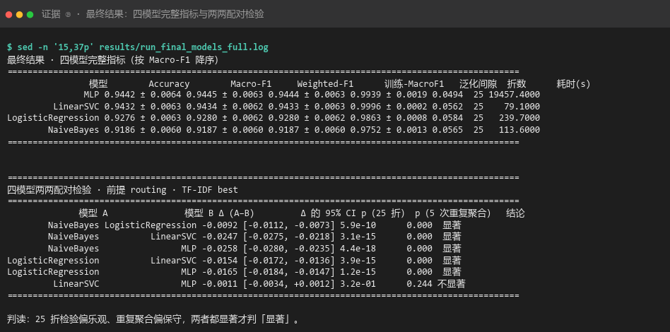

#### （4）同一批模型，在 5000 维与 50000 维下的对照

上面讨论的都是**最优配置**（50000 维）下的结果。但四个模型的相对位置**并不是固定的**——把词表缩回常规的 5000 维，排序就变了。两张表同前提、同代码路径、同一批 25 折，仅 TF-IDF 配置不同，可逐格对照。

**表 1 · 5000 维**（`max_features=5000`，未启用 `sublinear_tf`）

| 模型 | Accuracy | **Macro-F1** | Weighted-F1 | 训练-MacroF1 | 泛化间隙 |
|---|---|---|---|---|---|
| **LinearSVC** | 0.9187 ± 0.0070 | **0.9189 ± 0.0070** | 0.9188 ± 0.0070 | 0.9979 | 0.0790 |
| MLP | 0.9169 ± 0.0061 | 0.9173 ± 0.0060 | 0.9172 ± 0.0061 | 0.9898 | 0.0725 |
| LogisticRegression | 0.9054 ± 0.0068 | 0.9060 ± 0.0068 | 0.9059 ± 0.0068 | 0.9670 | 0.0610 |
| NaiveBayes | 0.9014 ± 0.0072 | 0.9017 ± 0.0072 | 0.9016 ± 0.0072 | 0.9446 | 0.0428 |

**表 2 · 50000 维**（`max_features=50000` + `sublinear_tf=True`）

| 模型 | Accuracy | **Macro-F1** | Weighted-F1 | 训练-MacroF1 | 泛化间隙 |
|---|---|---|---|---|---|
| **MLP** | 0.9442 ± 0.0064 | **0.9445 ± 0.0063** | 0.9444 ± 0.0063 | 0.9939 | **0.0494** |
| **LinearSVC** | 0.9432 ± 0.0063 | **0.9434 ± 0.0062** | 0.9433 ± 0.0063 | 0.9996 | 0.0562 |
| LogisticRegression | 0.9276 ± 0.0063 | 0.9280 ± 0.0062 | 0.9280 ± 0.0062 | 0.9863 | 0.0584 |
| NaiveBayes | 0.9186 ± 0.0060 | 0.9187 ± 0.0060 | 0.9187 ± 0.0060 | 0.9752 | 0.0565 |

（`results/model_metrics_routing_baseline_5x5.csv` 与 `model_metrics_routing_best_5x5.csv`）

**三条读数**：

**① 排序确实反转了，但两次都不显著。**
- 5000 维：LinearSVC 领先 MLP **+0.0016**，CI **[−0.0005, +0.0036]**，p=0.13 → **不显著**
- 50000 维：MLP 领先 LinearSVC **+0.0011**，CI **[−0.0034, +0.0012]**，p=0.32 → **不显著**

**两次的置信区间都跨零。** 所以"谁排第一"在两种维度下都**没有统计依据**——这正是思考题①那条经典结论的边界：它不仅说"线性模型表现好"，在本文的数据上更准确的表述是"**线性模型与这个非线性模型分不出高下，而线性模型便宜两个数量级**"。

**② MLP 是维度放开后受益最大的模型**（**+0.0272**，依次为 LinearSVC +0.0245、LR +0.0220、NB +0.0170）。也就是说，**它在 5000 维下的落后，部分来自特征不足，而不是表达能力不足**——这解释了为什么排序会反转。

**③ 泛化间隙的走向不一致，只有 NB 反着走。** LinearSVC（0.0790 → 0.0562）与 MLP（0.0725 → 0.0494）的间隙都在**下降**——特征变多反而更不过拟合；但 **NaiveBayes 从 0.0428 升到 0.0565**，是四个模型里唯一变差的，与它的训练分同步上升（0.9446 → 0.9752）一致。**"特征越多越不过拟合"不是普适规律，NB 就是反例。**


### 3.2 文本预处理消融

预处理是文本任务中变量最多的一环，必须逐项分离其贡献。我们设计了三个视角共 13 个配置：**累积阶梯**（逐级叠加，看边际贡献）、**邮件头分级**（单轴对照）、**单项独立**（各项单独作用于原文）。

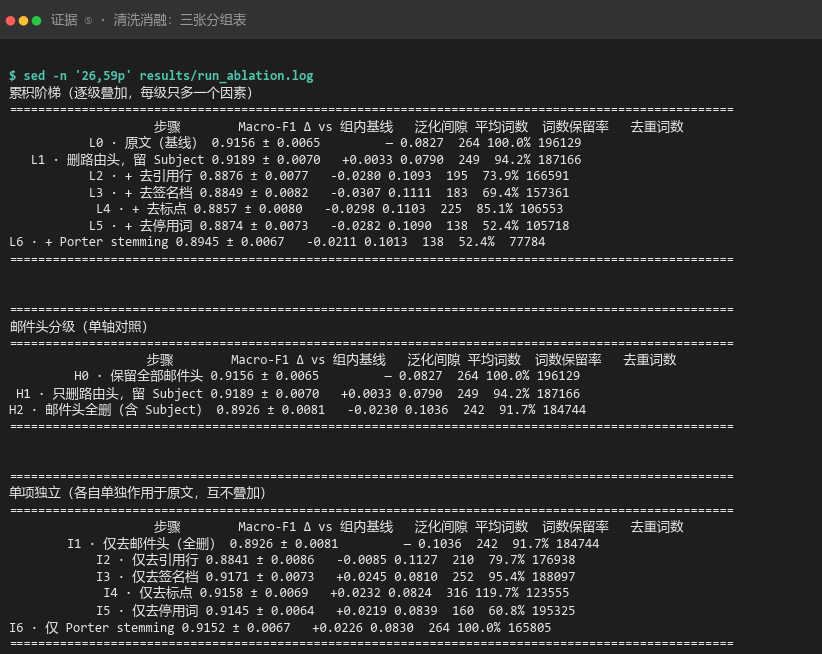


**单项独立结果**（基准 = 原文 0.9156，LinearSVC，25 折）：

| 操作 | Macro-F1 | Δ vs 原文 | 配对检验结论 |
|---|---|---|---|
| 仅去邮件头（全删） | 0.8926 ± 0.0081 | **−0.0230** | 显著有害 |
| 仅去引用行 | 0.8841 ± 0.0086 | **−0.0314** | 显著有害 |
| 仅去签名档 | 0.9171 ± 0.0073 | +0.0016 | 不显著 |
| 仅去标点 | 0.9158 ± 0.0069 | +0.0002 | 不显著 |
| 仅去停用词 | 0.9145 ± 0.0064 | −0.0010 | 不显著 |
| 仅 stemming | 0.9152 ± 0.0067 | −0.0004 | 不显著 |

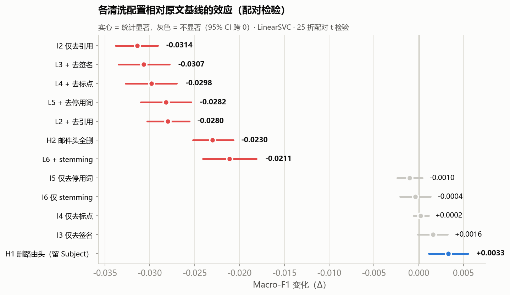

**四项发现**：

**（1）三项"标准清洗"是无效操作。** 去签名、去标点、去停用词、stemming 的效应均落在 ±0.002 内，配对检验 p 值 0.057~0.65，置信区间全部跨越零。机制是统一的：**凡是被 TF-IDF 加权机制自动处理掉的因素，显式再做一遍都是白工**——停用词在几乎所有文档出现，IDF 已将其降至近零；`TfidfVectorizer` 的默认分词本就按非字母数字切分，标点去除在词元层面早已等价；TF-IDF 亦容忍词形变化（加 stemming 后去重词表压缩 **15.5%**——单独一项时；叠加在完整清洗之上可达 26.4%——性能却毫无变化，说明**维度冗余不等于噪声**）。

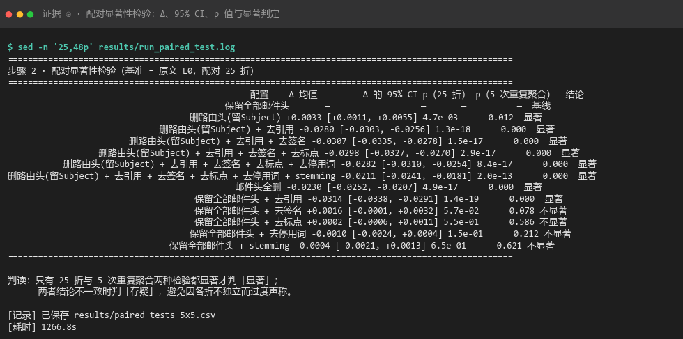

**（2）唯一有正收益的预处理是"删除路由元数据、保留 Subject"**（+0.0033，p=0.0047，显著）。逐部分测试邮件头的区分力可以发现原因：

| 输入 | 字符占比 | Macro-F1 |
|---|---|---|
| 只留 Subject 一行 | 2.3% | **0.8789 ± 0.0089** |
| 邮件头去掉 Subject | 7.6% | **0.6255 ± 0.0131** |
| 去掉邮件头后的正文 | 90.3% | 0.9271 ± 0.0073 |
| 全文 | 100% | **0.9434 ± 0.0056** |

（`results/header_parts_5x5.csv`，25 折；三种切片的字符占比合计约 100%，互为补集。）

**Subject 一行只占 2.3% 的字符，判别力却远强于其余全部头部**（0.8789 vs 0.6255）——它是内容的标题；而 From/Organization/Lines 这些是**元数据**，本身不该携带类别信息，却因为发件组织与新闻组高度绑定而成了捷径。实测 `Univ. of Pittsburgh Computer Science` 出现 61 次，**全部属于同一个类别**。因此正确做法是**删元数据、保留 Subject**，而非一刀切全删——全删会让全文损失 0.0230 且显著（`paired_tests_5x5.csv` 的"邮件头全删"行）。

**（3）一个被推翻的假设。** 我们原本判断"引用内容来自别人，与本文类别无关，是噪声"。实验证明相反：引用行携带话题信号（同一新闻组内话题高度一致），删除它损失 15.8% 的字符与 0.031 的 Macro-F1，是危害最大的一项。

**（4）但并非所有清洗都加重过拟合——加重的是"有害的清洗"。** 删路由头本身反而把间隙**降**到 0.0790；真正跳升的是叠加"去引用"之后（**0.109~0.111**）。机制上讲得通：**有害的清洗删掉了真信息**，模型只能在剩下的少量特征上硬记训练集；而删掉的是"捷径特征"（发件组织）时，泛化反而更稳。

**数据增强**：测了三种结构扰动（随机删除 10%/20% 词、随机交换词序），Δ 均为 +0.0004~0.0005，**全部不显著**——95% 置信区间上限约 **+0.0013**，而 TF-IDF 调参的收益是 +0.0287（原文前提下、100000 维），**相差 20 倍**。

值得注意的是"随机交换词序"——实测其 TF-IDF 特征向量与原文本**逐位相同**（200/200 条），因为词袋表示不含顺序信息。因此该组实为"恒等复制训练集"的对照组，它与真正改变特征的删除组给出相同提升，说明增益来自样本权重调整而非新信息。

**这个结论的范围要说清**：以上只说明**在"干净验证集上的准确率"这一评估口径下**，未观察到可测量的提升。而数据增强的另一个经典目的是**鲁棒性**——让模型对输入损坏更耐受。检验鲁棒性必须看**降幅**（干净分 − 扰动分），而不能只看干净分。为此我们补做了一组评估：

**训练用不用增强 × 在干净/扰动验证集上评估**（4 种训练增强 × 25 折；扰动 = 随机删除 10% 词，其种子与训练扰动不同）：

| 训练增强 | 干净验证集 | 扰动验证集 | **降幅** |
|---|---|---|---|
| 不做增强（基线） | 0.9434 ± 0.0062 | 0.9404 ± 0.0065 | **0.0030** |
| 随机删除 10% 词 | 0.9438 ± 0.0061 | 0.9406 ± 0.0065 | 0.0032 |
| 随机删除 20% 词 | 0.9438 ± 0.0061 | 0.9406 ± 0.0061 | 0.0031 |
| 随机交换 10% 词序 | 0.9438 ± 0.0059 | 0.9404 ± 0.0061 | 0.0035 |
| 类内词插入 10% | 0.9427 ± 0.0069 | 0.9397 ± 0.0063 | 0.0030 |

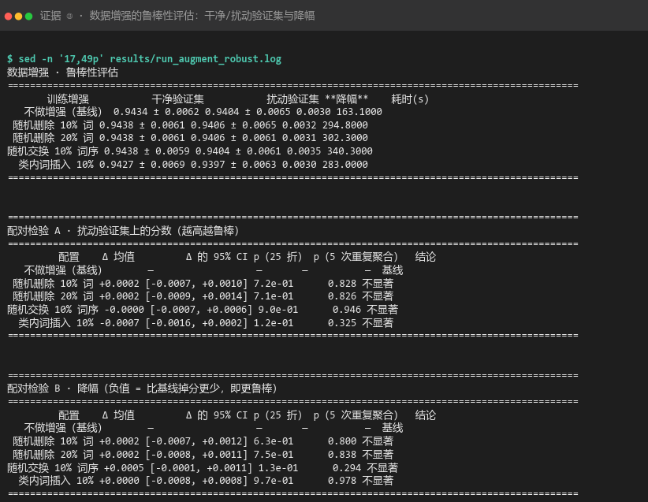

配对检验显示：无论以"扰动验证集上的分数"还是以"降幅"比较，四种增强相对基线**全部不显著**（Δ 落在 −0.0007 ~ +0.0005）。两条结论：

1. **基线本身就已很抗噪**——不做增强的模型面对 10% 词删除只掉 0.0030，**可提升的空间本来就极小**。
2. **没有任何一种增强让模型更抗噪**，即使是按构造保标签的"类内词插入"。

**最后，我们按任务书要求检查了"标签在变换后是否仍然成立"**：统计各类别的特征词在删除 20% 后的存活情况——关键词平均保留 87.6%~90.3%，但**有 2.4%~4.2% 的文档一个特征词都不剩**（平均约 3%，每 25 篇有 1 篇）。这说明**删除 20% 会把约 3% 的训练样本变成标签名存实亡的噪声样本**，它在提供抗噪性的同时也掺入噪声，两者相互抵消。

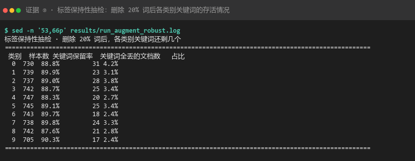

**进一步：把增强升级到语义级。** 以上均为**结构扰动**（删词、换词序），只改数量与顺序，不改词本身——报告局限性里已写明这一点。为补上"合理变换"这一环，我们把词替换成其**分布近邻词**（词向量由语料自身的 TF-IDF 经 TruncatedSVD 得到，无外部依赖；词向量与近邻表只在每折训练部分内建立，且候选近邻须满足 `P(c|w)/P(c)>1` 以保证标签成立）：

| 增强方式 | 干净验证集 | 扰动验证集 | 降幅 |
|---|---|---|---|
| 不加增强（基线） | 0.9434 ± 0.0062 | 0.9404 ± 0.0065 | 0.0030 |
| 近邻替换 10%（实际替换 3.5% 词元） | **0.9441 ± 0.0062** | 0.9409 ± 0.0061 | 0.0032 |
| 近邻替换 20%（实际替换 7.0% 词元） | **0.9443 ± 0.0061** | 0.9409 ± 0.0060 | 0.0034 |

配对检验给出一个**需要如实分辨**的结果：近邻替换 10% 相对基线 **+0.0007，95% CI [+0.0002, +0.0012]，p=0.013/0.004，显著**——这是结构扰动没能做到的。但**它与结构扰动之间的差异不显著**（+0.0003，p=0.44），即两类增强方法**打平**；且 **+0.0007 仅为 TF-IDF 调参收益（+0.0287，原文前提）的 1/40**。鲁棒性（降幅）上两种语义级增强同样不显著。

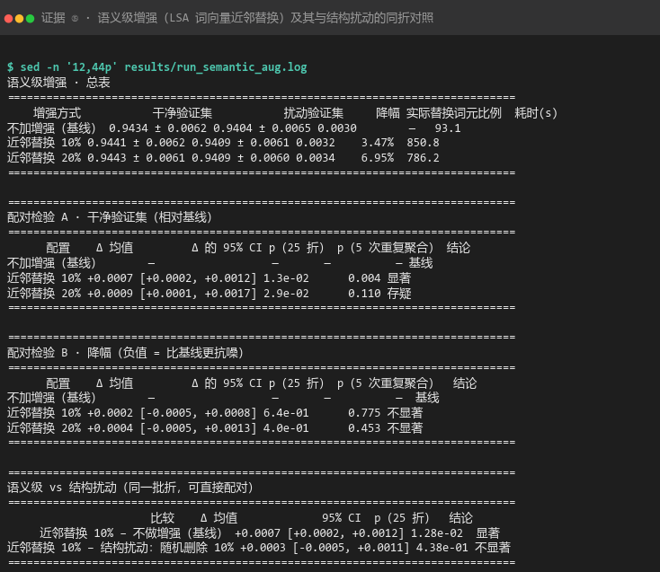

**综合结论**：在本数据集、本模型、本评估口径下——

1. **结构扰动类增强**在泛化能力与鲁棒性上均无可测量的收益；
2. **语义级增强**虽取得统计上显著的正收益，但幅度仅为调参收益的 1/40，且与结构扰动打平，**实际意义可忽略**；
3. 这与"模型的瓶颈不在样本量、而在类别间词汇重叠"（§四）一致——**要改善应该换表示，而不是加数据。**

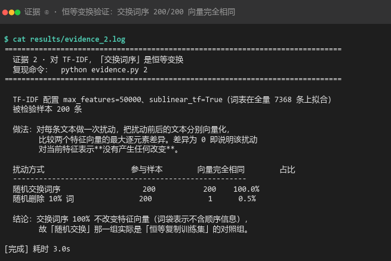

### 3.3 TF-IDF 参数调优

采用单参数敏感性扫描（每次只改一个参数，其余固定默认值），再补组合验证。以下为各参数相对默认值的效应（前提：删路由头留 Subject，LinearSVC，25 折）：

| 参数 | 取值 | Δ | 配对检验 |
|---|---|---|---|
| `max_features` | **20000** | **+0.0204** | 显著 |
| `max_features` | 2000 | −0.0423 | 显著 |
| `ngram_range` | (1,2) | −0.0135 | 显著 |
| `sublinear_tf` | True | +0.0028 | 显著 |
| `min_df` 2/5/10、`max_df` 0.5/0.9 | | −0.0004~+0.0007 | 全部不显著 |

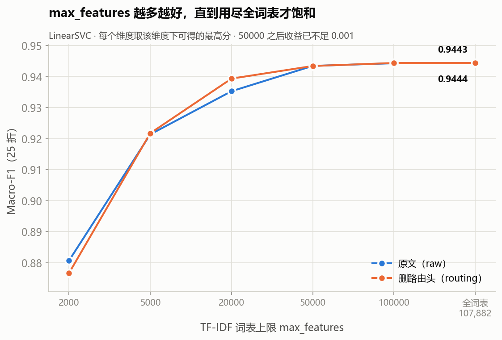

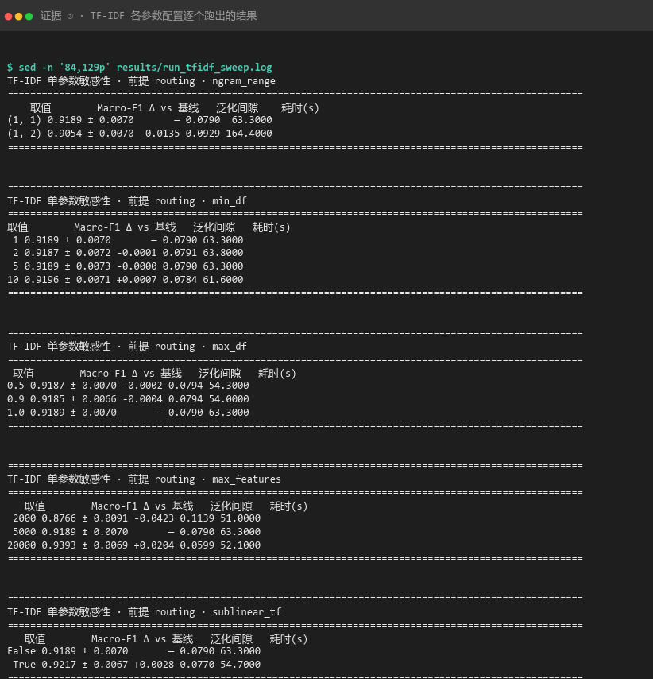

**四条结论：**

**（1）`max_features` 是唯一的大杠杆，且方向与直觉相反。** 2000→5000→20000→50000→100000 单调上升，**跨度 0.068**（0.8766 → 0.9444）。本前提（删路由头）下的全词表为 **104,468** 个词元，在 50000~100000 之间饱和（100000 与"不限"结果逐位相同）。**这直接反驳了"文本数据高维稀疏、所以应限制维度"的直觉。**

**最终取 50000 而非 100000，是一个明确的成本–收益折中，而非"两者等价"。** 配对检验（同一批 25 折）显示：

| 比较 | Δ | 95% CI | p（25 折 / 重复聚合） | 结论 |
|---|---|---|---|---|
| 100000 − 50000 | **+0.0010** | [+0.0006, +0.0013] | <0.001 / 0.011 | **显著** |
| 不限 − 50000 | +0.0010 | [+0.0006, +0.0013] | <0.001 / 0.011 | 显著 |

即 **100000 确实显著更优，但幅度只有 +0.0010**——仅为 TF-IDF 调参总收益（+0.0245，删路由头前提）的 **1/25**，而维度翻倍会使 MLP 的训练成本约翻倍。我们取 50000 作为**收益递减的拐点**；**若算力充裕，应取 100000 或不限。**

更关键的是**泛化间隙同时从 0.0790 降到 0.0599**（本前提下的值，`tfidf_sweep_routing_5x5.csv`）——特征更多，反而更不过拟合。解释：被截断的低频词恰恰是**类别特有**的词（新闻组的专业术语），信息密度高而噪声低；截断它们损失的是信号。

**（2）`ngram_range=(1,2)` 显著有害。** 二元组**增加**了特征却**降低**了性能，与上一条并不矛盾：**关键在于特征是否携带信息，而不是数量**。二元组在 7000 篇语料上极度稀疏，多数只出现一两次，IDF 权重虚高但泛化价值低。我们在扩大词表（5000→20000）后重测，二元组**依然稳定有害**（−0.006），从而排除了"稀疏度导致"的解释。

**（3）`sublinear_tf` 的收益可由数据直接解释。** 本语料文本长度跨度三个数量级，长文档中某词出现 50 次并不代表比出现 5 次重要 10 倍。对数压缩正对此症。

**（4）`min_df` / `max_df` 基本无效**（与"去停用词无效"同源：都是 IDF 已经自动处理的因素）。

**组合验证发现的一个交互效应**：`min_df=10` 单独测只有微弱正收益（**+0.0007**，且不显著），放进 `max_features=20000 + sublinear` 的组合却使该组合的收益**从 +0.0220 掉到 +0.0134（−0.0086）**。原因是 `max_features=20000` 想把低频词纳入，`min_df=10` 想把出现少于 10 篇的词剔除——词表放开后二者正面冲突。**只做单参数扫描会得出相反的建议。** 同理，二元组在扩大词表（5000→20000）后**仍稳定有害**（+0.0159 对 +0.0220，即 **−0.0061**），这排除了"二元组有害源于稀疏度"的解释。

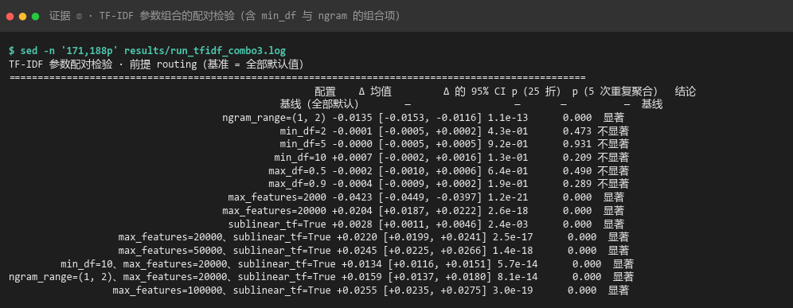

### 3.4 模型超参调优

**LinearSVC 的 C**（`max_features=50000`+`sublinear_tf`，删路由头）：

| C | 0.01 | 0.1 | **1.0** | 10.0 | 100.0 |
|---|---|---|---|---|---|
| Macro-F1 | 0.9060 | 0.9324 | **0.9434** | 0.9428 | 0.9413 |
| Δ vs C=1 | −0.0373 | −0.0110 | — | −0.0006 | −0.0021 |

呈教科书式的 U 形，最优在 C=1。**注意 C=10 与 C=1 统计上不可区分——最优点附近是一片平台而非尖峰**，说明在正确量级附近具体取值不敏感。

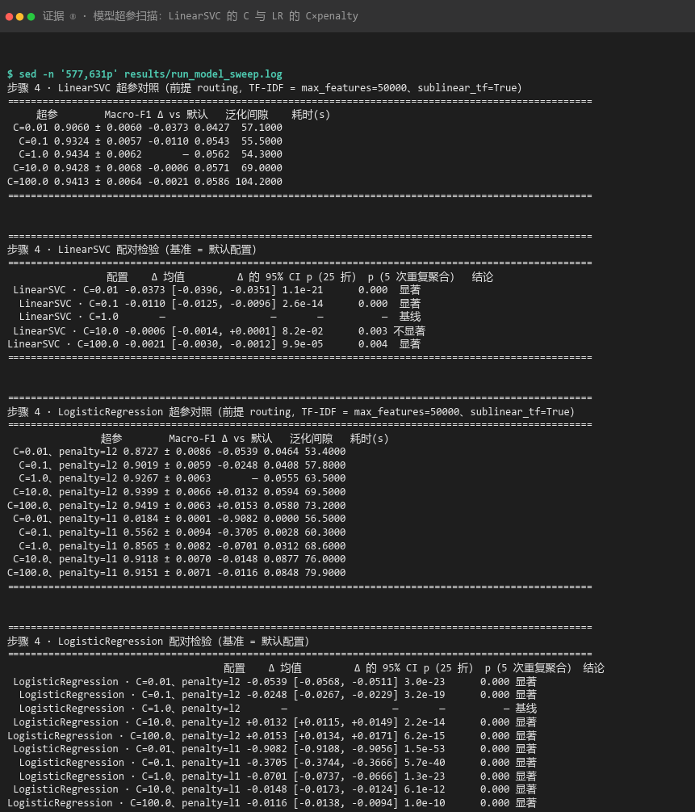


**LogisticRegression 的 C × penalty**（L1/L2 统一用 liblinear 求解器，以隔离出纯 penalty 效应）：

| C | l2 | l1 | l1 − l2 |
|---|---|---|---|
| 0.01 | 0.8727 | **0.0184** | **−0.8543** |
| 0.1 | 0.9019 | 0.5562 | −0.3457 |
| 1.0 | 0.9267 | 0.8565 | −0.0702 |
| 10.0 | 0.9399 | 0.9118 | −0.0281 |
| 100.0 | **0.9419** | 0.9151 | −0.0268 |

**L1 惩罚在全区间显著劣于 L2**，C=0.01 时 Macro-F1 只有 0.0184，**低于 10 类随机猜测的 0.10**。原因是强正则下的 L1 把所有系数压到零，模型输出退化为常数。**这是思考题一的关键反面证据**，详见 §5.1。

**嵌套交叉验证（无偏估计）**：外层 5 折估性能 × 内层 3 折调参，避免"用同一份 CV 选最优、又用它的分数报性能"带来的乐观偏差。

| 模型 | 嵌套 CV（无偏） | 各折独立选出的超参 |
|---|---|---|
| LinearSVC | **0.9453 ± 0.0052** | C=1（4/5 折）、C=10（1 折） |
| LogisticRegression | 0.9433 ± 0.0057 | C=100+l2（**5/5 折全一致**） |

无偏估计甚至略高于扫描取最优的分数，说明**本例的选优虚高小到测不出来**——因为 C 曲线是平台，挑最优几乎没有虚高空间。同时，各折独立选出的超参高度一致，说明**超参选择是稳定的，不是噪声驱动的**。

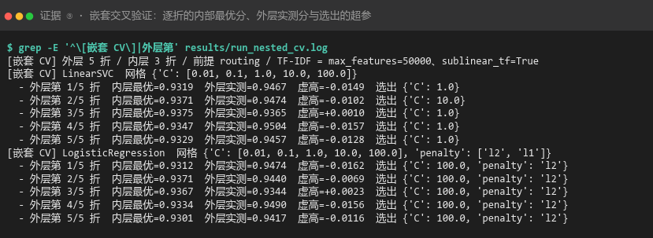

**NaiveBayes 的 `alpha`**（拉普拉斯平滑，同样在 routing + 50000 维下扫）：

| alpha | 0.01 | 0.03 | 0.05 | **0.1** | 0.2 | 0.3 | 1.0（默认） |
|---|---|---|---|---|---|---|---|
| Macro-F1 | 0.9353 | 0.9378 | 0.9390 | **0.9391** | 0.9365 | 0.9337 | **0.9187** |

**默认的 `alpha=1.0` 是整条曲线上最差的取值**——调到 0.1 能提升 **+0.0204**。
原因：`MultinomialNB` 假设输入是**计数**，而 TF-IDF 是归一化后的连续值（量级 0~1）。
`alpha=1.0` 的平滑量对这么小的"计数"来说等于先验压过证据本身。**这是"模型与特征表示不匹配"
的一个典型例子**，也说明调参前必须先确认模型的分布假设是否成立。

> **求解器口径**：上表 LR 的 C 扫描统一用 `liblinear`（为了隔离 penalty 效应，见本节 LR 表的说明），
> 因此 C=100 处记的是 **0.9419**；而 §3.1 主表的 LR 走 sklearn 默认的 `lbfgs`，
> 同配置下是 **0.9405**。两者相差 0.0014，是求解器差异，不是数据差异。
> **与 §3.1 对照时用 0.9405**，与本表内部纵向比较时用 0.9419。

**MLP 的结构 × 正则**（完整网格：4 种结构 × 3 个 alpha，共 12 组）：

| 结构 ＼ alpha | 1e-4 | 1e-3 | 1e-2 |
|---|---|---|---|
| (50,) | 0.9411 | 0.9437 | 0.9428 |
| **(100,)**（默认结构） | **0.9450** | **0.9455** | 0.9445 |
| (200,) | 0.9425 | 0.9426 | 0.9405 |
| (100, 50) | 0.9434 | 0.9424 | 0.9414 |

（5 折单次，`results/mlp_screen_5fold.csv`；区间取自助教 `TUNING.md`。黑体行为默认结构。）

四条读数：

- **(100,) 单隐层是最优结构**，而且**优势不是偶然**——它在三个 alpha 下都是同结构里最高的；
- **加宽有害**：(200,) 比 (100,) 低约 **0.003**；
- **加深也有害**：(100, 50) 比 (100,) 低约 **0.002~0.004**；
- **`alpha` 影响很小**（同结构内极差 ≤ 0.002），偏小的 alpha（1e-4 / 1e-3）略好；
- **默认配置 `(100, alpha=1e-4)` = 0.9450 就落在最优旁边**（最优 (100, 1e-3) = 0.9455，差 0.0005）。

**为什么"更复杂"反而更差？** 因为本任务的数据近似线性可分（§5.1）——**额外的容量没有结构可以学，只带来了方差**。这与 MLP 整体只与线性模型打平是同一件事的两个侧面。

**这解释了一个关键区别**：MLP 与 LinearSVC 同属"**默认值恰好够好**"的一类，
而 LR（默认 C=1）与 NB（默认 alpha=1.0）属于"**默认值离最优很远**"的一类。
**同样是"用默认参数"，四个模型里这几个字的含义完全不同**——这正是不该把它们并排排名次的原因。

#### 调参对等性：默认值的"运气"有多大
本节扫出的最优配置，回到 §3.1 的主表里重算（`results/tuning_fairness_5x5.csv`、
`results/nb_alpha_sweep_5x5.csv`）：

| 模型 | §3.1 主表值（默认参数） | 本节扫出的最优 | 调参后 | 变化 |
|---|---|---|---|---|
| MLP | 0.9445 | 完整网格最优仍是 `(100,)`，alpha=1e-3 | 0.9445 | **−0.00005（无提升）** |
| LinearSVC | 0.9434 | C=1 | 0.9434 | — |
| LogisticRegression | 0.9280 | C=100、l2 | **0.9405** | **+0.0125** |
| NaiveBayes | 0.9187 | alpha=0.1 | **0.9391** | **+0.0204** |

**四个模型的极差从 0.0258 缩到 0.0054**；LR 与 NB 从"显著不同"变成"不可区分"。

**这条修正是本实验最值得记的一个教训**：§3.1 的主表把四个模型并排排名次，四者用的都是
**库的默认参数**——表面上很公平。但"默认值"从来不是中性的：**它是库作者针对某类典型输入
挑的经验值，对这个数据集好不好，纯属巧合。** LinearSVC 的默认碰巧命中最优，LR 与 NB 的默认
则差得很远。**把"默认值恰好对"和"默认值恰好错"并排排名次，量出来的是运气，不是模型能力。**

而 §3.4 的扫描与嵌套 CV 其实早就给出了线索（LR 的 C 曲线在 C=1 处还在陡坡上、
C=100 被 5/5 折一致选中），只是当时没有把它接回主表。


---

### 3.5 训练成本对比

四模型的耗时是本实验的一项实际输出，但它**没法用长任务的墙钟时间来衡量**。

**证据：同一配置跑两遍，分数一样、耗时差一倍以上。** `run_final_models.log` 与
`run_final_models_full.log` 是同一份代码、同一份数据、同一个配置的两次运行：

| 模型 | 第一次 | 第二次 | 倍数 |
|---|---|---|---|
| NaiveBayes | 201.3 s | 113.6 s | 1.8× |
| LogisticRegression | 386.4 s | 239.7 s | 1.6× |
| LinearSVC | 227.7 s | 79.1 s | **2.9×** |
| MLP | 7890.0 s | 19457.4 s | **2.5×** |
| 合计 | 8705.8 s | 19890.6 s | 2.3× |

而这两次运行的 **Macro-F1 逐位相同**（0.9445 / 0.9434 / 0.9280 / 0.9187）。
**分数可复现，墙钟时间不可复现**——因为它把机器休眠、后台进程争抢、CPU 降频都算了进去。

两次运行的日志截图如下（第二次即 §3.1 已展示的截图 ⑲），耗时列可逐行对照：

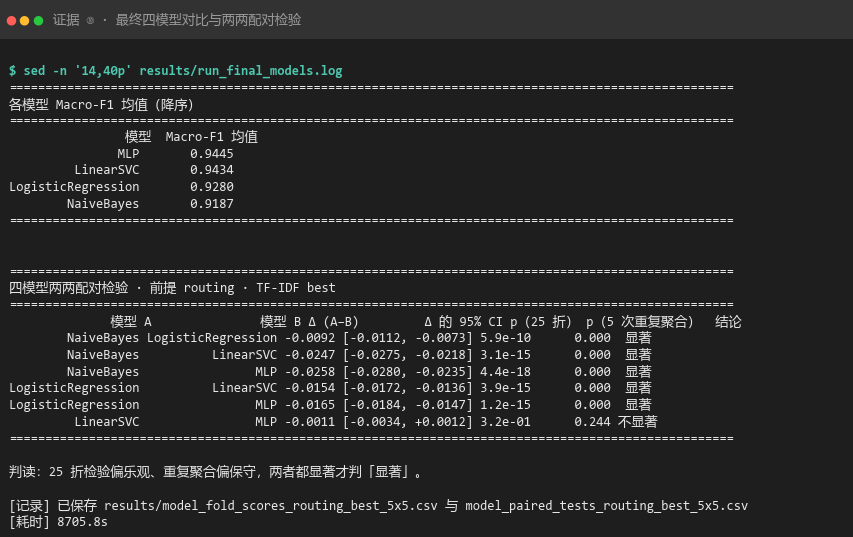

**改用受控单折测量。** 取同一折，在同一进程里背靠背跑完四个模型 × 两个维度
（截图 ⑳，`python evidence.py 5`，约 6 分钟）：

| 分类器 | 5000 维 | 50000 维 |
|---|---|---|
| NaiveBayes | 0.01 s | 0.04 s |
| LogisticRegression | 1.4 s | 5.2 s |
| **LinearSVC** | 0.9 s | **0.7 s** |
| **MLP** | 27.5 s | **173.6 s** |

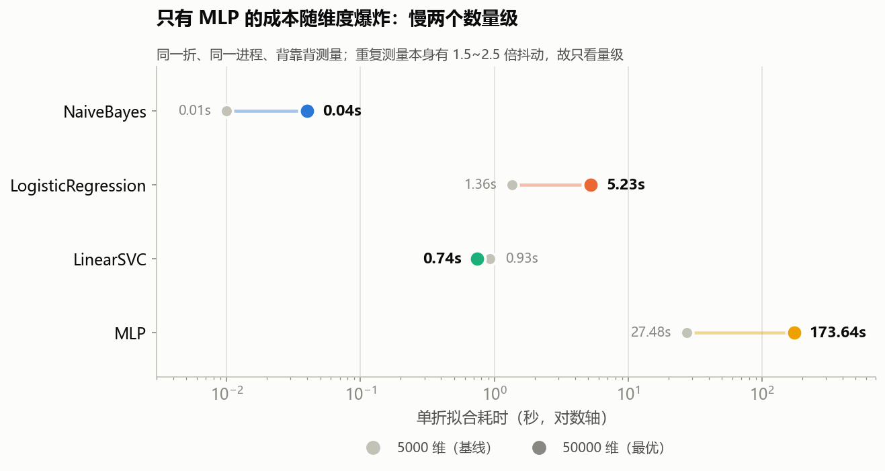

**结论：最优配置下，MLP 的单折拟合耗时比 LinearSVC 高两个数量级**（本次 235 倍）。
这个判断不依赖于某一次测量——**五次独立测量（含 §5.2 截图 ⑫ 那次）的比值分别是
140× / 213× / 169× / 175× / 235×**，全部落在两个数量级上。

**但具体的秒数不能引用。** 这五次测量里，MLP 在 50000 维下分别是
**181 s / 283 s / 261 s / 260 s / 174 s**——**同一折、同一进程重复测量也会差 1.5~2.5 倍**
（机器负载与 CPU 频率所致）。同理，各模型"维度翻 10 倍的成本放大倍数"也不稳定
（MLP 测到过 2.3×，也测到过 6.3×）。因此本文只保留"**差两个数量级**"这一稳健判断，
不写具体倍数。

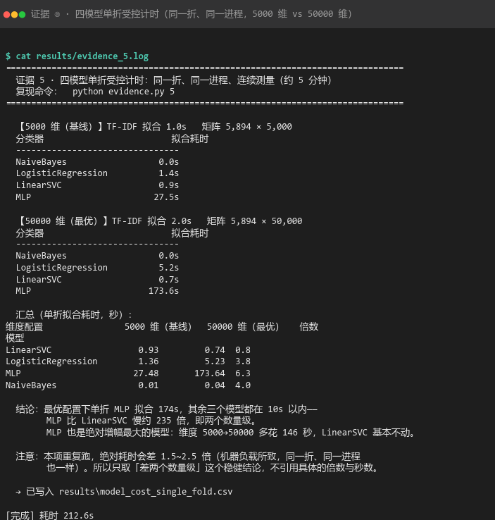

**机制**：差异来自 sklearn 把稀疏输入**稠密化**（截图 ⑫）。TF-IDF 矩阵每行只有 135 个
非零（稠密度 0.27%），MLP 却要在 5894 × 50000 的密集矩阵上运算（约 2.4 GB），
每次迭代 10.08 秒；LinearSVC 则始终按稀疏矩阵处理，每次迭代 0.03 秒。**维度越高，
这个惩罚越大**——这也是 §5.2 中"放开维度后 MLP 虽追平但代价高昂"的直接原因。

---

## 四、最优模型的效果与错误分析

§3.1 说明了四个模型**得了多少分**，本章说明最优模型（LinearSVC）**错在哪里、有没有规律**——这决定了下一步该改模型还是改表示。

用最优模型（LinearSVC，C=1）做 5 折折外预测——每个样本的预测都来自没见过它的模型，逐类别指标不会虚高。

类别名由各类别的 TF-IDF 高权重词反推得到（任务未提供类别名），仅供分析可读。

**先看整体错误分布**：非对角元几乎全部集中在**左上角三方块（类别 0/1/2）**，再加上它们与**第 7 类**之间的往返；其余行、列近乎空白。

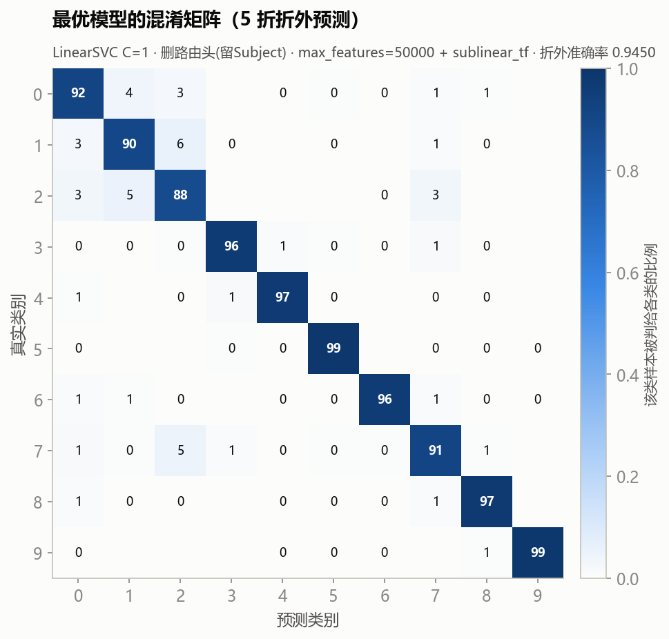

> 副标题里的 0.9450 是**单次 5 折的折外准确率**；§3.1 主表的 0.9432 是 **25 折**口径，两者不可直接相减。
>
> 矩阵用的是助教给的**类别编号**（任务未提供类别名），对应关系为
> 0 = 图形/3D、1 = Windows/DOS、2 = PC 硬件、7 = 电子电路，其余为跨领域类别。
> 副标题的 0.9450 是折外准确率。

**再看每一类自己的强弱**：

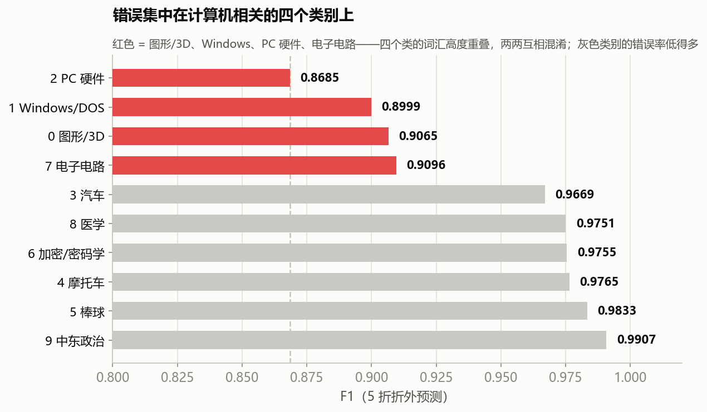

| 类别 | 反推依据 | F1 |
|---|---|---|
| PC 硬件 | drive, card, ide, scsi, controller | **0.8685** |
| Windows/DOS | windows, dos, microsoft, ms | **0.8999** |
| 图形/3D | graphics, image, 3d, files | **0.9065** |
| 电子电路 | circuit, power, used | **0.9096** |
| 汽车 | car, cars, engine | 0.9669 |
| 医学 | doctor, medical, pitt | 0.9751 |
| 加密/密码学 | clipper, key, encryption, escrow | 0.9755 |
| 摩托车 | bike, ride, riding | 0.9765 |
| 棒球 | baseball, game, team, players | 0.9833 |
| 中东政治 | israel, jews, arab, jewish, turkish | **0.9907** |

**错误不是均匀分布的，而是高度集中在一个类别簇。** 全部 8 个主要混淆对（≥15 例）的两端**都落在 {图形/3D, Windows, PC 硬件, 电子电路} 这四个计算机相关类别内**：

| 混淆对 | 例数 | | 混淆对 | 例数 |
|---|---|---|---|---|
| Windows → PC 硬件 | 43 | | PC 硬件 → 电子电路 | 25 |
| PC 硬件 → Windows | 39 | | PC 硬件 → 图形/3D | 25 |
| 电子电路 → PC 硬件 | 37 | | Windows → 图形/3D | 20 |
| 图形/3D → Windows | 26 | | 图形/3D → PC 硬件 | 19 |

而跨领域的类别（汽车、摩托车、棒球、医学、中东政治）**几乎不混淆**——两两之间的错误都不到 15 例。

**机制**：这四个类别共享大量词汇（computer、drive、system、problem、file），话题边界本身模糊；而"汽车 / 棒球 / 以色列政治"的词表几乎不重叠，一个强特征词即可分开。

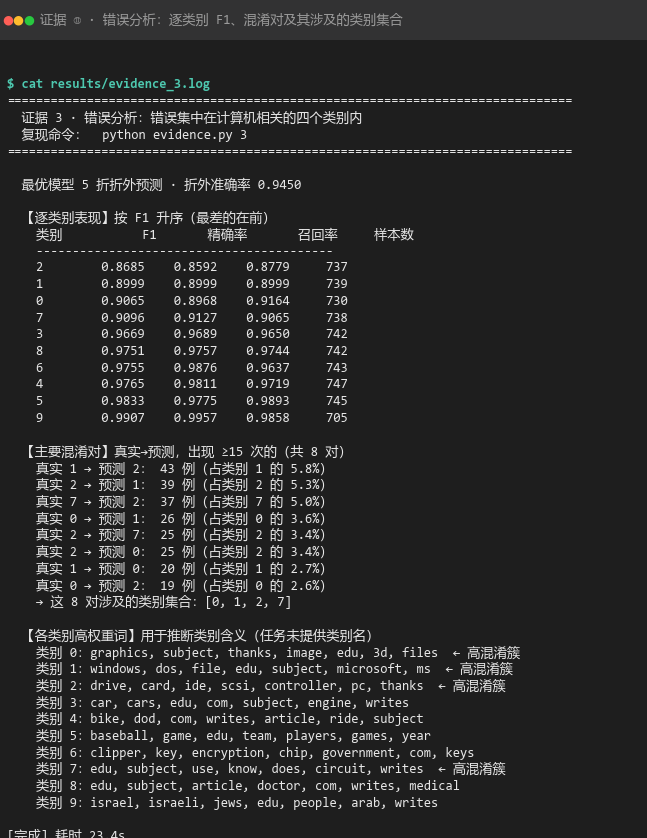


**这一结果直接指向实验一的结论**：线性模型依靠**词汇重叠度**做判别。类别间词汇越重叠，线性边界越难划分——模型在这四个类上失手，**不是因为模型能力弱，而是因为该问题在词袋表示下已接近不可分**。要改善需要更换表示（见 §5.3），而非更换模型。

---

## 五、思考题

### 5.1 为什么 SVM 和逻辑回归在文本分类上表现通常很好？

本实验的证据支持"高维稀疏下数据近似线性可分"这一机制。但**先说清一个陷阱**，否则证据会被误读：

**（1）高维下"训练分高"本身不构成证据。** 当特征维度 `d` 超过样本数 `n` 时，线性分类器的 VC 维是 `d+1`——**任何一组标签都能被完美分开**。我们做了**随机标签对照**验证（`results/random_label_control_5x5.csv`）：

| 标签 | 维度 | 训练 Macro-F1 | 验证 Macro-F1 |
|---|---|---|---|
| 真实 | 5000（d < n） | 0.9979 | **0.9196** |
| 真实 | 50000（d > n） | 0.9996 | **0.9452** |
| 随机打乱 | 5000 | 0.9348 | 0.0906 |
| **随机打乱** | **50000** | **0.9939** | 0.0912 |

**随机标签在 50000 维下也能被分开到训练 0.9939**，验证分则掉到 0.0912（10 类随机水平 0.10）。
所以在这个维度上，"训练分 0.9996"几乎不携带信息——**"近似线性可分"只能靠泛化性能来支撑**。
（5,000 维下 `d < n`，随机标签训练分只有 0.9348、分不开，那个设定下的训练分才是有效的。）

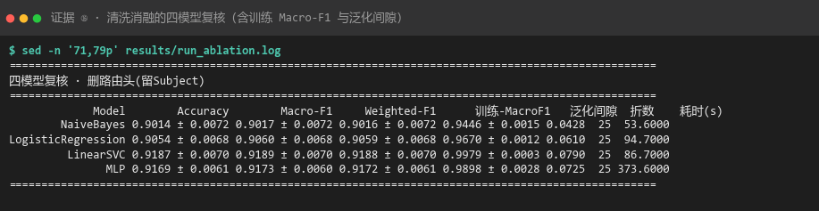

**（2）泛化性能确实支持这个论断，而且随维度单调增强。** 真实标签的验证分从 5000 维的 0.9196 升到 50000 维的 **0.9452**，而随机标签始终停在 0.091。**维度增加带来的不是"更容易拟合"，而是"真实结构的可分性更容易被线性边界捕捉"**——这正是"文本数据高维稀疏，线性模型天然适配"的机制。

**（3）正则化方式暴露了信息的组织形态。** L1 惩罚把系数逐个清零，导致性能崩溃至 0.0184（比随机猜测还低 0.08）；而 L2 惩罚保持所有系数非零，性能达 0.9419。这说明**判别信息分散在大量弱信号上，而非集中在少数强特征上**。线性模型之所以强，靠的正是"高维上大量弱信号的有效累加"——L1 恰好破坏了这个优势。这是反面的关键证据。

**（4）错误结构与词汇重叠度一致。** §四显示全部主要混淆对都在词汇高度重叠的类别簇内，跨领域类别几乎不混淆。这印证了线性模型的判别依据是词汇共现。

**（5）最优配置下泛化间隙小。** LinearSVC 在 `max_features=50000` 下的间隙为 **0.0562**，说明这个结构是真实的，而非模型记住训练集的假象。

**综合**：在高维稀疏的词袋表示下，数据近似线性可分；线性模型假设与数据结构匹配，参数少、方差低、正则化直接有效，因此表现优异。此时非线性模型的额外容量没有用武之地——这就是本实验中 MLP 仅与 LinearSVC 打平的原因。

> **关于"期望 SVM/LR 最好"与实测结果的差异**：二者并不冲突。期望说的是"线性模型表现**很好**"，实测 LinearSVC 确实拿到 **0.9434**（与最优并列，差距在噪声内）；期望**并不蕴含"线性模型必须排第一"**。
> 更完整的表述是"**线性模型已经达到该表示下的性能上限，更复杂的模型不会显著超过它**"——这正是本实验验证的：四个模型调参对等后挤在 **0.0054** 的区间内。
> 另外注意一个维度效应：**在常规的 5000 维设定下，LinearSVC 是高于 MLP 的**（0.9189 vs 0.9173）；只有把词表放开到 50000 维，MLP 才追上。而"文本分类用线性模型"的经典结论，正是在常规维度下得出的。

### 5.2 MLP 能否通过调整结构或训练参数进一步提升？是否存在过拟合风险？

**我们的验证**：MLP 是对"更多特征"受益最多的模型——从 5000 维的 0.9173 提升到 50000 维的 0.9445（**+0.0272**，超过 LinearSVC 的 +0.0245，均删路由头前提）。这说明它此前的劣势部分源于**特征不足**而非表达能力不足。

但在最优配置下，MLP 与 LinearSVC 的差距为 −0.0011，**95% CI [−0.0034, +0.0012] 跨零，统计上不显著**，而训练时间**贵两个数量级**（§3.5）。**在本任务中，MLP 的额外容量没有转化为可测量的优势。**

#### 调结构有用吗？——完整网格的结果：**更大更深的网络反而更差**

（4 种结构 × 3 个 `alpha`，共 12 组，5 折单次）

| 结构 ＼ alpha | 1e-4 | 1e-3 | 1e-2 |
|---|---|---|---|
| (50,)（更窄） | 0.9411 | 0.9437 | 0.9428 |
| **(100,)**（默认） | **0.9450** | **0.9455** | 0.9445 |
| (200,)（更宽） | 0.9425 | 0.9426 | 0.9405 |
| (100, 50)（更深） | 0.9434 | 0.9424 | 0.9414 |

- **加宽有害**：`(200,)` 在三个 alpha 下都比 `(100,)` 低约 **0.003**；
- **加深有害**：`(100, 50)` 比 `(100,)` 低约 **0.002~0.004**；
- **变窄也有害**：`(50,)` 低约 0.001~0.004；
- **`alpha` 影响很小**（同结构内极差 ≤0.002），偏小的 alpha 略好——与 LR（C 从 0.01 到 100 差 0.07）和 NB（alpha 从 1.0 到 0.1 差 0.020）形成鲜明对比；
- **默认配置 `(100, alpha=1e-4)` 就落在最优旁边**（最优 `(100, 1e-3)` 0.9455，差 0.0005）。

**结论：增大网络容量对提升性能没有帮助，反而有害。** 25 折确认也印证了这一点——把网格筛出的最优 `alpha`（1e-3）拿去跑 25 折，得 **0.94445**，而默认配置（1e-4）是 **0.94450**：**差 −0.00005，即调参带来了零提升，甚至略低**（四舍五入到四位小数两者同为 0.9445）。 机制与 §5.1 一致——本任务的数据**近似线性可分**，单隐层 100 个单元已经足够表达所需的决策面；**再多出来的容量没有结构可以学，只贡献方差**。这也解释了为什么 MLP 整体只与线性模型打平：**不是它没调好，而是这个问题不需要它那么大。**

#### 加大 epochs 有用吗？——诊断结果：**没有**

MLP 默认用 `early_stopping=True` 自行决定何时停。我们做了三种训练预算的对照（同一折、同一进程）：

| 配置 | 实际迭代 | 训练 Macro-F1 | 验证 Macro-F1 |
|---|---|---|---|
| 默认（耐心=10、上限=300） | **18** / 300 | 0.9929 | **0.9421** |
| 耐心=30（多练 3 倍才允许停） | **38** / 300 | 0.9929 | **0.9421** |
| 上限提到 1000 | **18** / 1000 | 0.9929 | **0.9421** |

**三种预算给出逐位相同的分数。** 默认配置在第 18 次迭代就停了，离上限 300 差得远；即使把耐心放大 3 倍、让它练到第 38 轮，结果一字不差。**模型早已收敛，`epochs` 根本不是瓶颈**——加大它只会浪费时间。

（`results/mlp_epoch_probe_5fold.csv`）

#### 过拟合风险：真实存在，但方向与直觉不同

**过拟合风险是真实存在的，但方向与直觉不同。** 我们用一条**学习曲线**来回答（4 个训练规模 × 4 个模型，同一配置，5 折 CV）：

| 训练样本量 | NaiveBayes | LogisticRegression | LinearSVC | MLP |
|---|---|---|---|---|
| 600 | 0.2549 | 0.1626 | 0.1396 | **0.1988** |
| 1500 | 0.1514 | 0.1066 | 0.1006 | 0.1064 |
| 3000 | 0.1007 | 0.0802 | 0.0768 | 0.0802 |
| 7368（全量） | 0.0557 | 0.0577 | 0.0544 | **0.0485** |

（表内数字为**泛化间隙** = 训练 Macro-F1 − 验证 Macro-F1）

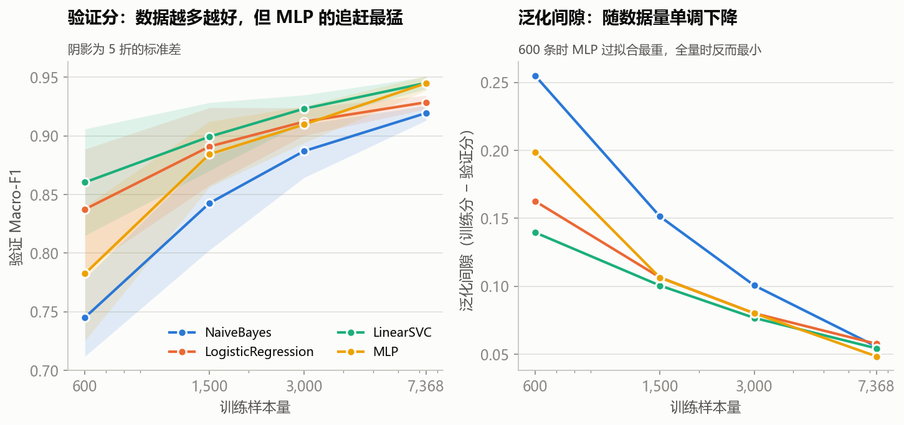

两组读数：

- **所有模型的间隙都随数据量单调下降**（600 → 7368 缩小 3~4 倍），这是典型的学习曲线行为——说明本任务**确实受数据量限制**，只是 §3.2 里那些增强方式提供的**有效样本量不够**。
- **MLP 在小样本下过拟合最严重**（600 条时 0.1988，明显高于 LinearSVC 的 0.1396），**但在全量下它的间隙反而最小**（0.0485 < 0.0544）。也就是说："MLP 更容易过拟合"**只在数据不足时成立**；数据给够之后，它的额外容量不再表现为过拟合，而是转化为与线性模型打平的性能（§3.1）。

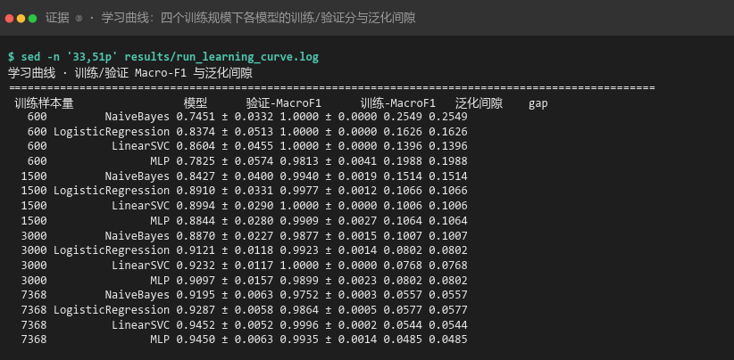

第三点与统计无关，是**工程层面**的代价：sklearn 的 `MLPClassifier` 在 50000 维下会把稀疏输入**稠密化**（每行仅 135 个非零，却需 **10 秒/次迭代**，对照 LinearSVC 的 0.03 秒），使训练成本超线性增长。**这不是过拟合，而是"参数效率"层面的失败**——同样的性能需要 2.4 GB 的密集矩阵运算。

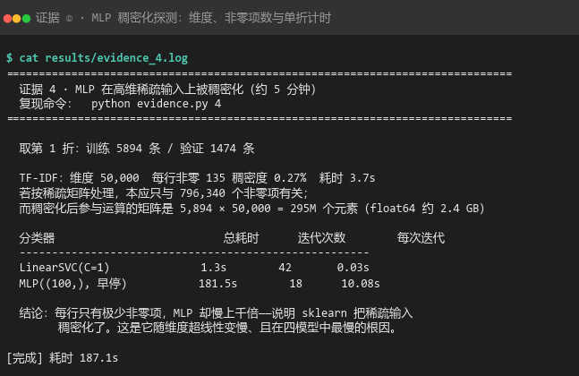


**诚实说明局限**：上表是 **5 折单次**口径，不与 §3.1 的 25 折表直接可比（最优配置 `(100, 1e-3)` 的 25 折确认在补跑）。
另外，这里的"结构"只覆盖了 `hidden_layer_sizes` **一个维度**——激活函数、学习率、批次大小等未做搜索；`TUNING.md` 建议激活函数保持默认，但这不是本实验验证过的结论。

### 5.3 除了 TF-IDF，还有哪些文本表示方法？

| 表示方法 | 特点 | 相对 TF-IDF 的取舍 |
|---|---|---|
| 词袋 / One-hot | 只统计词频，无加权 | 丢失 IDF 的区分力，高维且均权，通常劣于 TF-IDF |
| **TF-IDF**（本实验） | 稀疏、可解释、无需训练 | 维度高、**无语义**、无法处理同义与多义 |
| Word2Vec / GloVe | 稠密低维（100~300 维）词向量，可做平均或加权得到文档向量 | 维度骤降、能捕捉同义关系；但静态词向量**无法处理多义词**，且均值池化会丢失词序信息 |
| 主题模型（LSA / LDA） | 用潜在主题作为文档表示，天然降维 | 可缓解"词汇不重叠但语义相近"的问题，但主题数需调、可解释性弱于词 |
| **BERT 等预训练模型** | 上下文相关表示，能处理多义与长距离依赖 | 性能上限最高；代价是模型大、推理慢、需要 GPU |

**结合本实验的错误分析给出建议**：§4 表明剩余误差集中在**词汇重叠**导致的类别混淆上。这类问题恰恰是**语义表示**能缓解的——稠密词向量或上下文表示可以把"同义不同词"映射到相近位置，为主题边界模糊的类别提供 TF-IDF 无法提供的额外区分信息。

因此，若继续推进本任务，**首选方向是把 TF-IDF 换成预训练表示**（如 BERT 的 [CLS] 向量），同时保留本实验建立的评估协议（重复分层 CV + 配对检验 + 缺口检查），以便公平比较。次选是 LSA/LDA 降维，代价低、可与 TF-IDF 拼接使用。

---

## 六、实验结论汇总（结论 ↔ 证据）

本节把全文结论集中列出，每条都标注**支撑数据**与**证据位置**，对应任务书"实验报告应形成完整证据链"的要求。
截图编号见 `figs/term/`（「终端证据 N」），数据表见 `results/`。

### 6.1 数据划分

| # | 结论 | 支撑数据 | 证据 |
|---|---|---|---|
| C1 | 单次 80/20 划分的估计波动**比模型间真实差距还大**，因此改用交叉验证 | 单次 holdout：标准差 0.0070、极差 **0.0207**；5 折 CV：0.0025、**0.0073** | 截图 ① ｜ `split_comparison.csv` |
| C2 | 分层划分**确实生效** | 25 折类别占比相对全集最大偏差 **0.0006** | 截图 ② |
| C3 | 测试集全程未被读取，且这一点**可自证** | 全文件仅 1 处调用 `load_test()`；篡改 1 字节即被 SHA256 校验拦截 | 截图 ③ |
| C4 | 「重复 5 次」的额外收益**未经验证**（只验证了"CV 优于单次划分"） | — | §2.2 证据边界说明 + §7.2 局限性 7 |

### 6.2 数据预处理与增强

| # | 结论 | 支撑数据 | 证据 |
|---|---|---|---|
| C5 | 去签名 / 去标点 / 去停用词 / stemming **四项均为无效操作** | Δ = +0.0016 / +0.0002 / −0.0010 / −0.0004，**95% CI 全部跨 0**；其中 stemming 使去重词表压缩 **15.5%** 仍无性能变化 | 截图 ⑤⑥ ｜ `paired_tests_5x5.csv` |
| C6 | **唯一有正收益**的清洗是"删路由头、保留 Subject" | **+0.0033**，95% CI [+0.0011, +0.0055]，p=0.0047；逐部分对照：Subject 一行（占 2.3% 字符）得 **0.8789**，其余全部头部（7.6%）只有 **0.6255**，全删则掉 0.0230 | 截图 ⑤⑥ ｜ `header_parts_5x5.csv`、`paired_tests_5x5.csv` |
| C7 | "去引用行"**危害最大** | **−0.0314**，95% CI [−0.0338, −0.0291]（推翻"引用是噪声"的原假设） | 截图 ⑤⑥ |
| C8 | 只有**"有害的清洗"**才加重过拟合：删路由头本身反而减轻，叠加"去引用"后骤增 | 泛化间隙 0.0827（原文）→ **0.0790**（仅删路由头）→ **0.109~0.111**（叠加去引用） | `ablation_clean_5x5.csv` |
| C9 | 清洗的收益**可被"给足特征"替代** | 5000 维时 routing 高 +0.0033；100000 维时差距仅 +0.0001 | §3.3 对照表 |
| C10 | 结构扰动类增强**无收益** | 三种方式 Δ = +0.0004~+0.0005，**全部不显著** | 截图 ④ ｜ `augmentation_paired_5x5.csv` |
| C11 | "随机交换词序"对 TF-IDF 是**恒等变换** | 特征向量与原文本逐位相同 **200/200 条** | 截图 ④ |
| C12 | 鲁棒性上**同样无收益** | 基线降幅 0.0030，四种增强 0.0030~0.0035，**全部不显著** | 截图 ⑬ |
| C13 | 删除 20% 会在训练集里**掺入约 3% 标签噪声** | 各类 2.4%~4.2% 的文档丢掉全部类别特征词 | 截图 ⑭ |
| C14 | 语义级增强有**显著但极小**的收益，且与结构扰动**打平** | +0.0007（显著）；与结构扰动差 +0.0003，**p=0.44 不显著** | 截图 ⑮ |

### 6.3 TF-IDF 参数

| # | 结论 | 支撑数据 | 证据 |
|---|---|---|---|
| C15 | `max_features` 是**唯一的大杠杆**，方向与直觉相反 | 2000 → 100000 跨度 **0.068**；2000 掉 −0.0423，20000 涨 +0.0204 | 截图 ⑦ ｜ fig4 ｜ `tfidf_paired_tests_routing_5x5.csv` |
| C16 | **特征更多反而更不过拟合** | 泛化间隙 0.1139（2000 维）→ **0.0599**（20000 维）；100000 维进一步降到 0.0553 | `tfidf_sweep_routing_5x5.csv` |
| C17 | 二元组显著有害，且**扩表后仍有害**（排除"稀疏度"解释） | −0.0135；扩到 20000 维后仍 −0.006 | 截图 ⑦⑰ |
| C18 | `sublinear_tf` 有益 | **+0.0028**（显著） | 截图 ⑦ |
| C19 | `min_df` / `max_df` **基本无效** | 五种取值全部不显著 | 截图 ⑦ |
| C20 | `min_df` 与 `max_features` **争夺同一批低频词** | 单独 +0.0007；放进组合变 **−0.0086** | 截图 ⑰ |
| C21 | 最终取 50000 是**成本折中，而非"两者等价"** | 100000 − 50000 = **+0.0010**，CI [+0.0006, +0.0013]，**显著** | §3.3 配对检验表 |

> **总账**：从基线到最终共 **+0.0278**，其中清洗 +0.0033（占 12%）、TF-IDF 调参 +0.0245（占 88%）。
> **杠杆在特征表示，不在文本清洗**——这条把 C5~C9 与 C15~C21 串成一句话（图：§3.1 的 fig10）。

### 6.4 模型与调参

| # | 结论 | 支撑数据 | 证据 |
|---|---|---|---|
| C22 | **四个模型都用库默认参数**，但"默认值离最优多远"差别极大：调到各自最优后四者极差仅 **0.0054** | 主表极差 0.0258 → 对等后 **0.0054**；LR 0.9280→**0.9405**（C=100）、NB 0.9187→**0.9391**（alpha=0.1）；LR vs NB Δ=+0.0014 **不显著** | §3.1 对等性表、§3.4 ｜ `tuning_fairness_5x5.csv`、`nb_alpha_sweep_5x5.csv` |
| C23 | LinearSVC 与 MLP **统计上不可区分** | Δ = −0.0011，95% CI [−0.0034, +0.0012]，p=0.32 | 截图 ⑲ ｜ `model_paired_tests_routing_best_5x5.csv` |
| C24 | LinearSVC 的 `C` 呈 **U 形**，最优 `C=1` 且附近是**平台** | C=0.01 掉 0.0373；C=100 掉 0.0021；C=10 **不显著** | 截图 ⑧ ｜ fig5 ｜ `model_sweep_routing_5x5.csv` |
| C25 | **L1 惩罚全区间劣于 L2**，极端时比随机猜测还差 | C=0.01 时 L1 = **0.0184** < 10 类随机 0.10 | 截图 ⑧ |
| C26 | L1 稀疏化**反而加重**过拟合 | L1 间隙 0.085~0.088 vs L2 0.058~0.059 | `model_sweep_routing_5x5.csv` |
| C27 | 嵌套 CV 无偏估计 = **0.9453**；超参选择**稳定** | LinearSVC 0.9453 ± 0.0052；LR **5/5 折全选** C=100+l2 | 截图 ⑨ ｜ `nested_cv_5x5.csv` |
| C28 | 训练成本上 **MLP 比其他三个模型贵两个数量级**，且**墙钟时间不可复现** | 受控单折 MLP/LinearSVC 五次测量 = 140× / 213× / 169× / 175× / 235×；同一配置两轮墙钟差 1.6~2.9 倍而分数逐位相同 | 截图 ⑫⑳ ｜ fig12 ｜ `run_final_models*.log` |

### 6.5 错误分析与过拟合

| # | 结论 | 支撑数据 | 证据 |
|---|---|---|---|
| C29 | 错误**高度集中在一个类别簇** | **全部 8 个**主要混淆对两端都在 {图形/3D, Windows, PC 硬件, 电子电路} 内 | 截图 ⑪ ｜ fig7、fig8 |
| C30 | 跨领域类别**几乎不混淆** | 汽车/摩托车/棒球/医学/中东政治两两错误均 < 15 例 | 截图 ⑪ |
| C31 | 泛化间隙**随数据量单调下降** | 600 → 7368 缩小 **3~4 倍** | 截图 ⑱ ｜ fig11 ｜ `learning_curve.csv` |
| C32 | MLP **小样本下过拟合最严重、全量下间隙最小** | 600 条：0.1988 vs LinearSVC 0.1396；全量：**0.0485 < 0.0544**（25 折口径下同向：**0.0494 < 0.0562**） | 截图 ⑱ ｜ `learning_curve.csv`、`model_metrics_routing_best_5x5.csv` |
| C33 | 线性模型能把训练集**完全分开** | LinearSVC 在 600/1500/3000 三个规模训练 Macro-F1 均为 **1.0000**；全量 5000 维下达 **0.9979** | 截图 ⑱⑯ |
| C34 | MLP 在 50000 维下被 sklearn **稠密化** | 每行仅 135 个非零，却需 **10.08 秒/迭代**（LinearSVC 0.03 秒） | 截图 ⑫ |
| C35 | 高维下**"训练分高"不构成证据**——`d > n` 时任何标签都能被线性分开 | **随机打乱标签**在 50000 维下训练分仍达 **0.9939**，验证分掉到 0.0912；真实标签同一设定下验证 **0.9452** | §5.1 ｜ `random_label_control_5x5.csv` |
| C36 | 加大 MLP 的 epochs **没有收益**——模型早已收敛 | 默认 18/300 次迭代早停；耐心放大 3 倍（练到 38 轮）与上限提到 1000，三种预算给出**逐位相同**的 0.9929 / 0.9421 | §5.2 ｜ `mlp_epoch_probe_5fold.csv` |
| C37 | **增大 MLP 的容量反而有害**：更宽更差、更深也更差；默认结构即最优，且**调参收益为 0** | (100,) 0.9450~0.9455 ＞ (50,) 最高 0.9437 ＞ (100,50) 最高 0.9434 ＞ (200,) 最高 0.9426；最优 alpha 的 25 折确认 = **0.94445，比默认值低 0.00005（无提升）** | §3.4、§5.2 ｜ `mlp_screen_5fold.csv`、`mlp_tuned_25fold_5x5.csv` |
| C38 | **维度会改变模型排序，但两次都不显著** | 5000 维 LinearSVC＞MLP（+0.0016，p=0.13）；50000 维 MLP＞LinearSVC（+0.0011，p=0.32）；两次 95% CI 均跨零。MLP 是维度放开后受益最大的模型（+0.0272） | §3.1(4) ｜ `model_metrics_routing_baseline_5x5.csv` |

> **结论与局限的一致性**：以上结论均限定在"本数据集 + 词袋表示 + 本评估口径"内。**不能外推**的部分已逐条列在 §7.2 局限性——例如"MLP 的超参只做了部分筛选"（C37 只覆盖 `(50,)` 与 `(100,)`）、"重复次数未验证"（C4）。

---

## 七、创新点与局限性

### 7.1 主要创新点

**（1）把配对显著性检验做成评估的标准动作。**
本实验所有"某方案更好"的断言都有逐折配对 t 检验支撑。**直接成果**：发现"删除路由头"的 +0.0033 是显著的（p=0.0047），而它在"均值 ± 标准差"的常规读法下会被判为噪声。原因在于同一批折的难度是各方案共有的，配对做差消除这份共同方差后可显现真实差异。代价极低（复用同一批折，无需额外训练）。 【证据：§2.4 配对检验表 · 截图 ⑥】

**（2）清洗消融的三视角设计。**
累积阶梯（边际贡献）+ 邮件头分级（量化捷径价值）+ 单项独立（分离单项效应），三组共享配置、按开关组合去重，共 13 个配置覆盖全部视角。相比只做"清洗 vs 不清洗"的二分对照，能定位到具体是哪一项、以什么幅度起作用。 【证据：§3.2 三张分组表 · 截图 ⑤】

**（3）参数组合验证，而非只做单参数扫描。**
因此发现了 **`min_df` 与 `max_features` 争夺同一批低频词**的交互（`min_df=10` 单独 **+0.0007** 且不显著，放进 `20000+sublinear` 组合后使收益从 +0.0220 降到 +0.0134，即 **−0.0086**）。只做单参数扫描会给出相反的建议。 【证据：§3.3 组合验证段 · 截图 ⑰】

**（4）用对照排除解释，而不止于报告现象。**
发现"二元组有害"后，进一步在扩大词表（5000→20000）的条件下重测——二元组仍稳定有害，从而**排除了"稀疏度导致"这一解释**，把原因定位到二元组本身的信息质量。 【证据：§3.3 组合验证段 · 截图 ⑰】

**（5）错误分析定位到类别簇，并推导出改进方向。**
不是简单报告混淆矩阵，而是识别出全部主要混淆对都落在同一类别簇内，据此论证"这是词袋表示的固有困难，换模型解决不了"，从而把改进方向指向表示方法而非模型。 【证据：§四 错误分析 · 截图 ⑪】

**（6）数据增强的泄露防护与一个意外对照组。**
明确指出"先增广再划分"是隐蔽泄露（原始版与扰动版分落训练/验证，常规查重无法发现），并实现为只在 CV 折内增广训练部分。此外实证发现**"随机交换词序"对 TF-IDF 是恒等变换**（特征向量 200/200 逐位相同），该组因此成为"恒等复制训练集"的对照组——它与真正改变特征的删除组提升相同，证明增益来自样本权重调整而非新信息。 【证据：§3.2 数据增强段 · 截图 ④】

**（7）测试集的可自证隔离。**
测试集移出工作目录，代码中仅提交分支可读；读取前逐字节校验 SHA256，运行日志记录数据指纹。**创新点在于"可自证"**——保留了文件与指纹，因此能证明提交文件由助教原始测试集生成，而非口头声明。 【证据：§2.3 防数据泄露 · 截图 ③】

**（8）用随机标签对照识破了一个"看起来成立"的论证。**
"高维稀疏下数据近似线性可分"这是文本分类的经典论断，而常见的论证方式是"线性模型能把训练集近乎完全分开"（我们最初也这么写）。但**这个论证在高维下是无效的**：当特征维度 `d` 超过样本数 `n` 时，线性分类器的 VC 维为 `d+1`，任何标签都能被完美分开。我们用**随机标签对照**验证了这一点——打乱标签后，训练分仍有 **0.9939**，而验证分掉到 **0.0912**（随机水平）。**因此该论断只能靠泛化性能来支撑**，报告 §5.1 已按此重写。 【证据：§5.1 ｜ `random_label_control_5x5.csv`】

**（9）用"训练预算对照"回答"加大 epochs 有没有用"，而不是靠推理。**
MLP 默认开启早停，因此"多练会不会更好"不能凭直觉回答。我们做了三种预算的对照（默认 / 耐心×3 / 上限提到 1000），**三者给出逐位相同的分数**——模型在第 18 轮就收敛了。 【证据：§5.2 ｜ `mlp_epoch_probe_5fold.csv`】

### 7.2 局限性

1. **训练集与测试集之间存在约 35 条近重复样本**（前 200 字符重合），系切分方式所致，无法修复。影响量级约占测试集 1.4%。
2. **类别名为反推所得**，任务未提供，可能与真实新闻组名有出入。
3. **MLP 的结构搜索只覆盖了 `hidden_layer_sizes` 一个维度**。12 组网格（4 种结构 × 3 个 alpha）已跑完，结论是**增大容量反而有害**（§3.4 / §5.2）；但**激活函数、学习率、批次大小等未做搜索**，且筛选是 **5 折单次**口径、未做嵌套 CV。因此更强的断言——"MLP 怎么调都不如 LinearSVC"——**不成立**。本实验能说的只是：**在这个搜索空间内，MLP 的最优配置并未超过 LinearSVC**。
4. **LR 与 NB 的最优配置是在看过全部数据之后才补做的**（§3.4），属于**事后修正**，不是预注册的分析计划。它们的 C=100 / alpha=0.1 只在**同一份数据的同一批折**上验证过，没有独立验证集确认。相对地，LinearSVC 的 C=1 与所有 TF-IDF 参数都经历了嵌套 CV（外层估计 + 内层选参），是这个偏差更小的一个。
5. **数据增强只测了结构扰动与 LSA 近邻替换**，未测回译，也未用预训练词向量构造近邻（后者需引入额外依赖）。且 LSA 词向量在 7368 篇语料上质量有限——实测出现过 `subject→re`、`article→writes` 这类"引用标记之间互换"，它们确是分布近邻，但语义增益有限；为保证近邻可靠只允许出现在 ≥20 篇文档里的词被替换，因此实际替换率仅 3.5%~7% 词元。
6. **`max_features` 的搜索上限是当前语料的全词表**。若换用更大语料，"越多越好"的趋势未必延续，需重新确定拐点。
7. **全部结论基于单一数据集**。10 分类、类别均衡、20 Newsgroups 风格——这些条件之外的迁移性未经检验。
8. **重复次数（5 次）未做单独验证。** 本实验用 5 折 ×5 重复，但只验证过"CV 优于单次 80/20 划分"，**没有验证"重复 5 次优于只重复 1 次"**。重复 5 次使每个样本被验证 5 次、覆盖 5 套不同划分，但额外稳定性收益的大小未知。若追求效率，单次 5 折可能是更划算的选择——这需要专门的对照实验（同一批种子下比较两种方案报告均值的波动）才能定论。

---

## 附录：复现说明

全部实验固定随机种子 `42`，环境版本锁定（scikit-learn 1.7.1 / Python 3.10.22），中间结果以 CSV 存于 `results/`（38 份结果表 + 24 份运行日志），日志含数据文件 SHA256 指纹以核对数据未被改动。

```bash
conda activate AILab && cd data-Project1
python main.py --smoke        # 自检流程（600 条样本，不写文件）
python main.py --ablation     # 清洗消融（13 配置 ×25 折）
python main.py --tfidf-sweep --clean-preset both   # TF-IDF 参数扫描
python main.py --model-sweep  # 模型超参扫描
python main.py --nested-cv    # 嵌套交叉验证
python plots.py               # 生成全部图表
python main.py --submit --models LinearSVC   # 生成提交文件（唯一读取测试集的命令）
```

**提交文件的生成**：`predictions.csv` 共 2457 行、单列、无表头，取值 0~9，顺序与测试集一致。
生成命令见上（日志：`results/run_submit.log`），模型为 **LinearSVC**，配置为正文 §3.1
选定的 **routing 清洗 + `max_features=50000` + `sublinear_tf=True`**，训练集上的
25 折 CV 复现了 **0.9434 ± 0.0062**，与 §3.1 表格一致。

> ⚠️ **一处已修复的实现缺陷（如实记录）**：`--submit` 分支原先写的是 `make_pipeline()`，
> 不带任何参数，因此**无论前面调了哪些参，提交的都是"原文 + 5000 维"的 baseline**——
> 与报告选出的方案相差约 **+0.028** Macro-F1（CV 口径）。实测这一缺陷让 2457 条预测中
> 有 **141 条**与最优方案不同。现已改为默认使用选定配置（新增 `--final-config`），
> 并把实际配置打印进日志。**这类"代码看起来正常、但与论证结论脱节"的问题，
> 只有把提交文件和报告并排核对才会暴露。**
